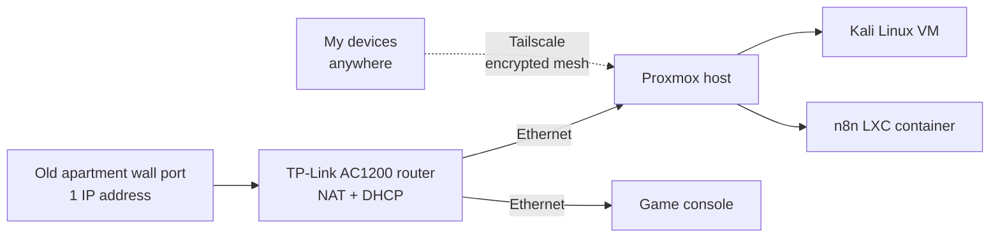

# Proxmox Homelab

My self hosted lab for cybersecurity practice, automation, and experimenting with infrastructure. One machine running Proxmox VE hosts my security testing VM, my automation workflows, and whatever I'm learning next.

## Why I Built It

- **Cyber labs.** A safe, isolated place to practice security tooling without touching anything I don't own.
- **Automation.** Somewhere always on to run my own bots and workflows.
- **Self hosting.** Replace paid streaming subscriptions with a media server I control.
- **Experimenting.** Break things, rebuild them, and learn how real infrastructure fits together.

## Why Proxmox

My original plan was a headless Ubuntu Server install: no GUI, SSH only. Before committing, I realized everything I wanted to run (a security VM, automation, a media server, future labs) meant running **multiple isolated systems on one machine**. Ubuntu could do that, but I'd be bolting virtualization on myself. Proxmox VE is a hypervisor, so it's built for exactly that from the start. I still get full CLI control on the server itself, plus remote management from my laptop over Tailscale.

What sold me on Proxmox VE:

- **Free and open source**, with no license limits on features
- **Lightweight.** It's a slim Debian based hypervisor with no desktop on the host, so most of the hardware goes to the workloads
- **Runs VMs and containers side by side.** Full KVM virtual machines for things like Kali, and lightweight LXC containers for always on services
- **Web based management** from any browser
- **Room to grow** into practicing cloud style concepts locally, like templates and spinning machines up and down on demand

## Hardware

| Component | Spec |
|-----------|------|
| Motherboard | ASUS TUF GAMING B650E-E WIFI (AM5, PCIe 5.0) |
| CPU | AMD Ryzen 5 7600X (6 cores / 12 threads) |
| Cooling | Arctic Liquid Freezer III Pro 360mm AIO |
| RAM | 16 GB G.Skill DDR5-6000 |
| Storage | 1 TB M.2 NVMe |
| Graphics | Integrated Radeon (dedicated GPU planned) |
| Power Supply | MSI MAG A750GL PCIE5, 750 W 80 Plus Gold, ATX 3.1 |
| Case | Thermaltake Tower 600 |
| Total cost | ~$1,000 to $1,200 (core parts ~$830 after tax, plus the NVMe and extras) |

**Built to grow.** The AM5 platform and PCIe 5.0 board leave a long upgrade path, the 360mm liquid cooler keeps temps stable under sustained VM loads, and the ATX 3.1 power supply has a native PCIe 5.0 GPU connector with headroom for a dedicated GPU once I start running local AI models. The integrated graphics are only needed for initial setup, since the server runs headless and is managed entirely over the network.

## Network

> **Current status:** The lab is temporarily offline after a move. My new place has no ethernet wall ports and weak Wi-Fi, so I'm working out a reliable wired connection before bringing it back up. The setup below is from my previous apartment.

### Problem: one wall port, one IP

My old apartment's ethernet port only handed out **a single IP address**, so only one device could be online through it at a time. When I plugged in the lab, my console lost its connection, and vice versa.

**How I figured it out:** I wrote down exactly what was happening (whichever device connected last worked, the other dropped) and researched those symptoms until I found that the port was limited to one device.

**The fix:** I plugged my own router into the wall port. The router takes that one IP and uses **NAT** to share it, while **DHCP** hands each device behind it its own private address. Now the lab and the console are both wired into the router and online at the same time.

**Why wired:** The lab runs on ethernet only, even though the hardware supports Wi-Fi. Proxmox bridges its VMs over the network connection, and that works reliably on a wired link.

### Remote access: Tailscale, zero open ports

I access the lab remotely through **Tailscale** instead of port forwarding on my router.

Port forwarding means exposing services directly to the internet, and one forgotten open port is all it takes to leave the lab vulnerable. Tailscale creates an encrypted private network between my own devices, so I can reach the Proxmox dashboard from anywhere **without opening a single port** on my home network.

> IP addresses and hostnames are intentionally left out of this wiki.

## What Runs On It

| Workload | Type | Purpose |
|----------|------|---------|
| Kali Linux | VM (4 cores, 8 GB RAM, 60 GB disk) | Web app security practice with Burp Suite and ffuf. Install process documented in my [Linux Installation Notes](https://github.com/DJXSEC/Linux-Installation-Notes) |
| n8n | LXC container | Workflow automation, including a crypto market signal bot |

**Why a VM for Kali but a container for n8n:** Kali needs a full operating system with its own kernel and a desktop, so it gets a VM. n8n is a single always on service, so a lightweight container saves RAM and boots in seconds.

## Lessons Learned

- **Read the network before blaming the hardware.** My only real problem had nothing to do with Proxmox. It was the apartment's network rules.
- **Secure remote access from day one.** Choosing Tailscale up front meant I never had to worry about cleaning up exposed ports later.
- **Plan for what's next.** Picking a GPU ready power supply up front means adding a graphics card later won't require a rebuild.

## Roadmap

- [ ] Get a stable wired connection at the new place and bring the lab back online
- [ ] More storage
- [ ] Jellyfin media server
- [ ] GPU for local AI models
- [ ] More security labs, documented as their own wikis and write ups
